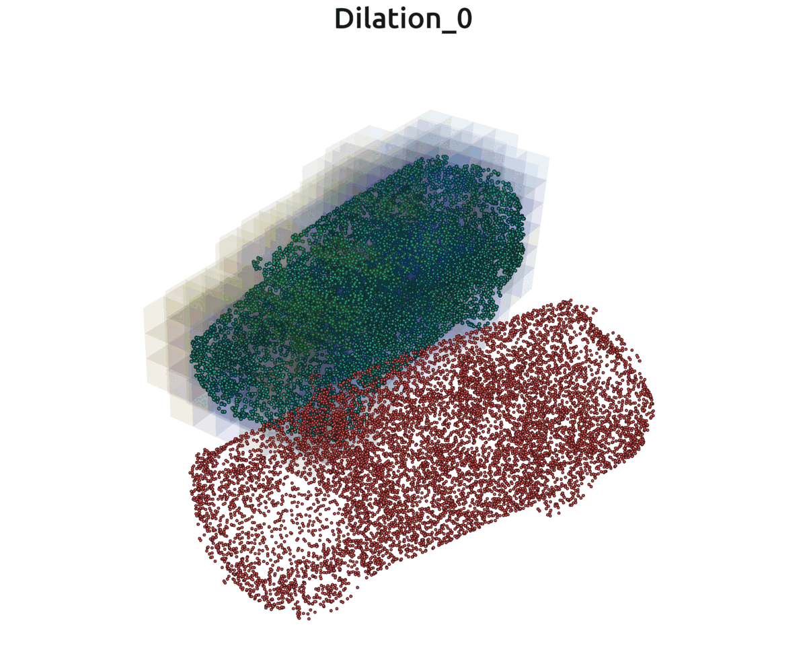

# VAN-ICP: GPU-Accelerated Approximate Nearest Neighbor Search for ICP Registration via Voxel Dilation


## ✅ Code Release

We have released the implementation of VAN-ICP included in an updated version [VANICP-V2](https://github.com/changqiong/VANICP4Em).

For details, please refer to TACO extension [Accelerating Nearest Neighbor Search in 3D Point Cloud Registration on GPUs
](https://dl.acm.org/doi/10.1145/3716875) 
and [A Dynamic Memory Assignment Strategy for
Dilation-Based ICP Algorithm on Embedded GPUs](https://arxiv.org/pdf/2512.04996) 

## Introduction

This repository is the efficient CUDA implementation of VAN-ICP (Voxel-dilAtioN-based ICP) for 3D point cloud registration. VAN-ICP accelerates the nearest neighbor search (NNS), the most computationally intensive step in ICP, with a dilated voxel strategy. NNS can be performed locally instead of globally when points are close. Voxelization is applied to form local areas, and the dilation of voxelization is proposed to increase the overlap areas. The method is especially suitable for parallel processing and GPU acceleration.

## Voxel Dilation

Voxel maps with different dilation layers (0-10) at the voxel resolution of 4. Colors indicate indexes of root voxels, namely voxels with the same color are dilated from the same root voxel. As the number of dilation layers increases, overlap areas expand. As the number of dilation layers increases, overlap areas increase.

<p align="middle">
  
</p>
<!-- <p style="text-align: center;">Dilation of voxelized point cloud</p> -->

## VAN-ICP Registration

The registration example of VAN-ICP. As the iterations proceed, overlap areas also increase.

<p align="middle">
  
</p>
  <!-- <p style="text-align: center;">VAN-ICP registration</p> -->

## References
If you find this project useful in your research, please consider citing our work:
```bibtex
@INPROCEEDINGS{wangVANICP,
  author={Wang, Weimin and Chang, Qiong},
  booktitle={ICASSP 2023 - 2023 IEEE International Conference on Acoustics, Speech and Signal Processing (ICASSP)}, 
  title={VAN-ICP: GPU-Accelerated Approximate Nearest Neighbor Search for ICP Registration via Voxel Dilation}, 
  year={2023},
  pages={1-5},
  doi={10.1109/ICASSP49357.2023.10095859}}

@article{changTACO,
author = {Chang, Qiong and Wang, Weimin and Miyazaki, Jun},
title = {Accelerating Nearest Neighbor Search in 3D Point Cloud Registration on GPUs},
issue_date = {March 2025},
publisher = {Association for Computing Machinery},
address = {New York, NY, USA},
volume = {22},
number = {1},
issn = {1544-3566},
url = {https://doi.org/10.1145/3716875},
doi = {10.1145/3716875}
}

@article{changVANICPV2,
  title={A dynamic memory assignment strategy for dilation-based ICP algorithm on embedded GPUs},
  author={Chang, Qiong and Wang, Weimin and Zhong, Junpei and Miyazaki, Jun},
  journal={arXiv preprint arXiv:2512.04996},
  year={2025}
}


